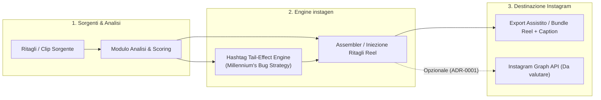

# Architecture Decision Records (ADR) & Master Task Backlog — instagen

Questa cartella raccoglie gli **Architecture Decision Records (ADR)** e il **Backlog Operativo** del progetto **instagen** (`Noobucodonosor/instagen`), consolidando le decisioni architetturali, di sicurezza e di prodotto.

---

## Indice degli ADR

| ID | Titolo | Stato | Priorità | Autori / Fonti |
| :--- | :--- | :--- | :--- | :--- |
| **[ADR-0001](./0001-core-architecture.md)** | Architettura Core: Analisi, Montaggio Ritagli Reel e Strategia Hashtag | Proposto | **P1 — Alta** | `@Noobucodonosor` |

---

## Diagramma Architetturale del Sistema

---

## Master Task Backlog (Tutti i Task Censiti)

> **Nota:** Lo stato live (`Open` / `Closed`) di ciascun task è tracciato sulle **GitHub Issues** del repository. Usa `closes #<NumeroIssue>` nei commit per chiuderle automaticamente.

| Task ID | Issue | ADR | Titolo Task | File Coinvolti | Priorità | Assegnatari |
| :--- | :--- | :--- | :--- | :--- | :--- | :--- |
| **TASK-CORE-01** | `#1` | [ADR-0001](./0001-core-architecture.md) | Discovery e decisione canale Instagram (Export assistito vs Graph API) | `docs/adr/0001-core-architecture.md` | **P1 — Alta** | `@Noobucodonosor` |
| **TASK-CORE-02** | `#2` | [ADR-0001](./0001-core-architecture.md) | Setup scheletro progetto, dipendenze e `.env.example` | `README.md`, `.env.example` | **P1 — Alta** | `@Noobucodonosor` |
